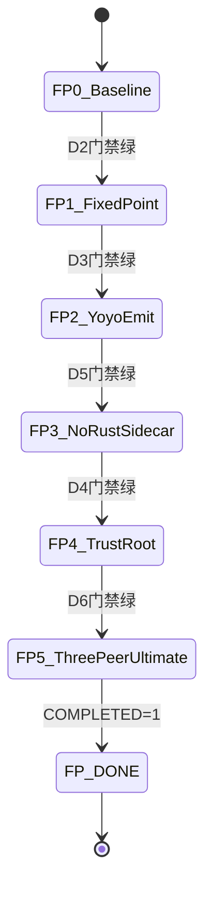

# AUTO-FIXEDPOINT — 全自动契约（post-v1.0）

> **目的**：把「三链各自吐同一颗终极二进制，且发射全程不再只靠 Rust」写成 **有限状态机**，让 agent 可无人值守推进。  
> **不是** invent Stage 17；**不是** Thompson 证明；**不是**无界 tip 工厂。

```
ACTIVE=0
COMPLETED=1
COMPLETED_AT=2026-11-06
AUTO_READY_TO_END=0
NORTH_STAR=三链终极二进制 + 非 Rust 唯一发射器
STOP_ONLY=停 | ACTIVE=0 | hard-block | COMPLETED=1
PARENT=AUTO_TO_1.0.md (v1.0 已 COMPLETED=1；本轨独立)
BOARD=本文件「状态机」节
AUDIT=2026-11-06 · FP-0…DONE 门禁轨 COMPLETED=1；OW-SEED 仍 CUT；full-text 可 DIFF；≠ Thompson
NEXT=AUTO-FULLBAR.md (满配续轨 · COMPLETED=1 · 2026-11-06)
```

## 0. Agent wake 协议（机器可读）

1. 读 `AUTO_TO_1.0.md`（历史 v1.0 轨；`COMPLETED=1` 勿回改）  
2. 读 **本文件** `ACTIVE`  
3. 若 `ACTIVE=0` → **停手**（除非用户本回合明确 `继续固定点` / `ACTIVE=1`）  
4. 若 `ACTIVE=1` 且 `COMPLETED=0` → 执行 **下一未勾 `FP-*`**（一项 / tick），绿了才勾  
5. 全部 `[x]` → 写 `COMPLETED=1` · `ACTIVE=0` · 停

### 触发词（仅本轨）

| 用户输入 | 行为 |
| --- | --- |
| `固定点自动` / `AUTO-FIXEDPOINT=1` / 把本文件 `ACTIVE=1` | 开本轨无人值守 |
| `继续固定点` | 开一刀下一未勾 FP（即使 ACTIVE=0） |
| `停` | `ACTIVE=0`；停 |

禁止：用本轨重新 invent `STAGE17_*` 看板；禁止把 DETECTION-BANLIST 当进度尺。

---

## 1. DONE 谓词（唯一毕业条件）

下列 **全部** 机器绿，才可 `COMPLETED=1`：

| ID | 谓词 | 门禁（fail-closed） |
| --- | --- | --- |
| D1 | 同一份源 `yoyo/projects/yoyo.ty`（或锁内 `.tyb`）可被 JS / Rust / asm 编译 | 既有 three-peer / body-ddc 门禁绿 |
| D2 | 任一条链产出的 genN 再自编译 → genN≡genN+1（`.text` DDC + 约定全文件窗） | `stage9-pure-m4` 类 fixed-point；或等价 `yoyo diff` EQUAL |
| D3 | 存在 **YOYO PE 发射 hop**：emit 步骤上 `rust_yoyo_exe_on_emit_hops=ABSENT`，产物 ≡ Rust `yoyo link` 对照 | `scripts/stage17-ow-seed-yoyo-emit.ps1` GREEN |
| D4 | **信任根 provenance 不再写 `rust_stage9_gen1_*` 为唯一祖先** | `scripts/stage-fixedpoint-fp4-trust-root.ps1` GREEN（dual pin + emit hops ≡ gen4）；ancestry 仍诚实记 Rust；≠ OW-SEED CLOSED |
| D5 | 生产信任主路径 **不以 cwd Rust `yoyo_rt.dll` 为唯一路径** | `scripts/stage-fixedpoint-fp3-d5.ps1` GREEN（CreateProcess-compiler = OW-RT CLOSED）；Gate I 仅诊断，RED 不否决 D5 |
| D6 | **三链冷启**各自吐出的终极二进制在 **DONE 窗**彼此 EQUAL（`selfhost-body`；禁止只比 Rust 窗；全文件/.text 可 DIFF） | `scripts/stage-fixedpoint-three-peer.ps1` GREEN |

**诚实**：D1–D6 门禁均已有绿路径；OW-SEED 仍 CUT（ancestry 仍记 Rust）；full `.text` 可 DIFF。  
**禁止**：把 D3/D6 绿说成 OW-SEED CLOSED 或 full-PE 三链≡。

---

## 2. 规格图（信任 / 发射）

```text
                    ┌──────────── yoyo.ty / .tyb ────────────┐
                    │         （同一份锁内源）                 │
                    └───────┬──────────┬──────────┬─────────┘
                            │          │          │
                       ┌────▼───┐ ┌────▼───┐ ┌───▼────┐
                       │  JS    │ │ Rust   │ │  asm   │  ← 三链 peer
                       │ peer   │ │ peer   │ │ peer   │
                       └────┬───┘ └────┬───┘ └───┬────┘
                            │          │          │
                            └─────┬────┴────┬─────┘
                                  ▼         ▼
                            seed_js    seed_rust   seed_asm
                                  │         │          │
                                  └────┬────┴────┬─────┘
                                       ▼         ▼
                                 目标：seed_* 全 ≡ U（终极）
                                       │
                                       ▼
                              U ──自编译──► U'  ≡ U
                                       │
                         emit hop 上允许：YOYO PE（非 Rust exe）
                         禁止 DONE 宣称：仅 Rust yoyo.exe 能吐第一颗
```

### OW 附录（非本源尺，仅病历）

```text
OW-RT  (runtime sidecar)     → CLOSED @ S3.738 (human A) · CreateProcess-primary
OW-SEED (trust-root emit)    → CUT · 本轨主攻 D4/D5
OW-IAT / STUB / REL-*        → CUT 冻结 · 默认不自动开刀
```

---

## 3. Typed graph（有限状态 · 禁止 invent 新状态名）

状态集合固定为下表。**只允许**沿边推进；不得新增 `FP-7`/`S4.*` 除非人类改本文件。



| State | 含义 | 进入条件 | 下一刀 |
| --- | --- | --- | --- |
| `FP0` | 基线绿 | ddc / gen12 / three-peer 窗既有绿 | 复验命令，不新功能 |
| `FP1` | 自编译不动点 | D2 | 钉 genN≡genN+1 复验脚本出口 |
| `FP2` | YOYO 发射 hop | D3 | `stage17-ow-seed-yoyo-emit.ps1` |
| `FP3` | 无 Rust sidecar 主路径 | D5 | Gate I 类 / OW-RT CLOSED 对齐 |
| `FP4` | 信任根去 Rust 唯一祖先 | D4 | 扩 trust-root pin + 门禁 |
| `FP5` | 三链终极 EQUAL | D6 | `stage-fixedpoint-three-peer.ps1` |
| `FP_DONE` | 毕业 | D1–D6 全绿 | `COMPLETED=1` · `ACTIVE=0` |

**类型约束（typed）**

| 符号 | 类型 | 规则 |
| --- | --- | --- |
| `Source` | `yoyo.ty` \| locked `.tyb` | 三链输入必须同一 hash |
| `Peer` | `js` \| `rust` \| `asm` | 每 peer 独立 emit；禁止伪 peer（同一二进制换名） |
| `Seed` | PE bytes + sha256 | `Seed(peer_i) == Seed(peer_j)` 在 DONE 窗 |
| `Emitter` | `rust_yoyo_exe` \| `yoyo_pe` \| `js_host` \| `asm_host` | DONE 要求存在非 `rust_yoyo_exe` 的冷启或 hop |
| `Disposition` | `CUT` \| `CLOSED` | 仅当对应 D\* 全绿才可 CLOSED；observe≠CLOSED |

---

## 4. 有限 checklist（每 tick 一项）

- [x] **FP-0** 基线复验（2026-11-06）：`yoyo.exe test ddc` PASS · `test gen12` EQUAL `1ec3766f` · `stage12-three-peer-io.ps1` GREEN  

- [x] **FP-1** 不动点复验（2026-11-06）：`stage9-pure-m4.ps1 -SkipBuild` GREEN · gen1→gen4 · DDC EQUAL `1ec3766f` · unattended-ui OK  

- [x] **FP-2** YOYO emit（2026-11-06）：`stage17-ow-seed-yoyo-emit.ps1 -SkipStage9` GREEN · hops=2 · `rust_yoyo_exe_on_emit_hops=ABSENT` · disposition=CUT  

- [x] **FP-3** D5（2026-11-06）：`stage-fixedpoint-fp3-d5.ps1 -SkipBuild` GREEN · production=CreateProcess-compiler · OW-RT CLOSED · Gate I diagnostic RED（不否决）· OW-SEED 仍 CUT  

- [x] **FP-4** D4（2026-11-06）：`stage-fixedpoint-fp4-trust-root.ps1 -SkipStage9` GREEN · dual provenance · sole_rust=ABSENT · operational≡gen4 · disposition=CUT  

- [x] **FP-5** D6（2026-11-06）：`stage-fixedpoint-three-peer.ps1 -SkipBuild` GREEN · JS=Rust=asm selfhost-body EQUAL · compared≥17805 · full_text observe=DIFF  
- [x] **FP-DONE**（2026-11-06）：D1–D6 门禁轨齐 · `COMPLETED=1` · `ACTIVE=0` · OW-SEED **仍 CUT** · 非 Thompson / 非 full-PE 三链≡  


### Hard block（写到本节「阻塞」后停）

- 需要人类授权才能把某洞从 CUT→CLOSED（历史先例：OW-RT human A）  
- 缺少可运行门禁脚本且无法在本 tick 内最小实现  
- 政策 / SCOPE-CUT 禁止的宣称路径  

**阻塞：（2026-11-06 终极审核 + 固定点自动实跑）**

| ID | 阻塞 | 影响 |
| --- | --- | --- |
| HB1 | ~~three-peer 脚本缺失~~ **已清 @ FP-5**（DONE 窗=selfhost-body；非 full-PE） | FP-5 ✅ |
| HB2 | Gate I 仍 RED（诊断）— **已用 D5 替代门禁绕过**（`stage-fixedpoint-fp3-d5.ps1`）；不把 Gate I 当 D5 唯一谓词 | FP-3 ✅；Gate I 全绿仍是可选加深 |
| HB3 | ~~sole rust provenance~~ **已清 @ FP-4**（dual pin）；三链冷启根仍未立（归 HB4/FP-5） | FP-4 ✅；OW-SEED 仍 CUT |
| HB4 | ~~语义缺口~~ **已钉**：D6=selfhost-body 三链 EQUAL；full `.text`/PE 仍可 DIFF（observe） | 勿把 DIFF 全文件说成 D6 红 |
| HB5 | FP3=D5→FP4=D4 边序易混 | 文档债 |
| HB6 | 无 `/loop` 时需会话持续唤醒 | 调度债 |

**实跑进度：** FP-0…FP-DONE ✅ · 本轨 **COMPLETED=1** · `ACTIVE=0`。  
**诚实剩余：** OW-SEED CUT（ancestry 仍记 Rust gen1）；Gate I 诊断 RED；full `.text` 可 DIFF；`AUTO_READY_TO_END=0` 仅针对「OW-SEED CLOSED / full-PE 三链≡」超轨宣称。  


---

## 5. 每 tick 工作量与 CI

- 默认：**一个** `FP-*`（实现或验收或两者）  
- 本地先绿；遵守 `.cursor/rules/ci-anti-thrash.mdc`  
- WIP 默认不 push；毕业 FP-DONE 才可按用户/规则 commit  
- 红了修到绿再勾；不得清 Actions 装绿  
- **弹窗杠住**：固定点相关 smoke 须 `. scripts\lib\unattended-ui-harden.ps1` + `Enable-YoyoUnattendedUiHarden`（WER DontShowUI + ErrorMode + WerFault watchdog + 超时杀）。崩了仍 RED（exit code），不等人点框。不覆盖 UAC / 应用主动 MessageBox。

---

## 6. 文档地图（全自动依赖的 SoT）

| 角色 | 路径 |
| --- | --- |
| 本轨开关 + typed graph | **`AUTO-FIXEDPOINT.md`（本文件）** |
| v1.0 历史自动轨 | `AUTO_TO_1.0.md` |
| 本源看板 | `POST-1.0-HOLE-CHECKLIST.md` |
| 语言/自举规范 | `PROMPT-v3.md` |
| 洞账本 | `SCOPE-CUT-v1.0-hole-inventory.md` · `SCOPE-CUT-v1.0-ow-seed-observe.md` |
| OW-RT CLOSED 证据 | `SCOPE-CUT-v1.0-ow-rt-yoyo-runtime.md` |
| 禁吹牛 | `DETECTION-BANLIST-v1.0.md` |
| Agent 规则 | `.cursor/rules/stage4-auto-owner.mdc` |

**刻意不放进本轨**：无界功能、新 Stage 编号、Thompson-proof、全文件永久 EQUAL 作唯一毕业（窗策略以 D6 脚本为准）。

---

## 7. 人类怎么开全自动

1. 确认认同 §1 DONE 谓词  
2. 把本文件 `ACTIVE=0` → `ACTIVE=1`（或说 `固定点自动`）  
3. 离席；agent 按 FP-0→DONE 推进  
4. 说 `停` 或改 `ACTIVE=0` 即停  

---

*初版 2026-11-06 · 为「完善文档 → 真正全自动」补齐规格图 + typed graph + 有限门禁*
